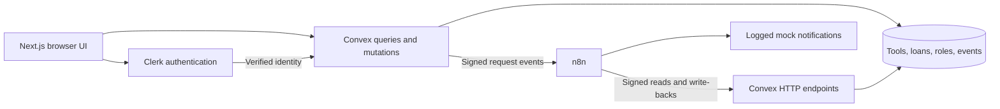

# LendLoop

Borrow what you need. Lend what you don't.

LendLoop is a neighborhood tool-lending application for the Fluence take-home assignment. Neighbors list tools, request borrowing dates, approve or decline requests, and track returns. n8n handles request notifications and overdue reminders.

> Status: core app and local signed n8n automation are implemented. Request notifications and overdue reminders use a durable logged mock adapter. Both primary workflows have been published locally and exercised against development Convex. See docs/AUTOMATION.md for setup and operational limits.

## Documentation

- [Submission checklist and demo script](docs/SUBMISSION.md).

- [Verification results](docs/VERIFICATION.md): local fixes, checks, and remaining limits.

- [Setup and usage walkthrough](docs/USAGE.md): sign-in, listings, borrowing, returns, admin access, and troubleshooting.

- [Implementation plan](docs/IMPLEMENTATION_PLAN.md): sections, implementation approach, and product decisions.
- [Task checklist](docs/TASKS.md): work required for a complete submission.
- [Automation guide](docs/AUTOMATION.md): workflows, security, example payloads, and failure recovery.

## Architecture

Next.js renders public and authenticated interfaces. Clerk provides identity. Convex owns persistence, authorization, request transitions, and integration endpoints. n8n orchestrates notification delivery and the daily reminder job. The UI never decides whether a user is authorized.

## Interface

The Next.js App Router interface uses Base Web and Styletron for interactive controls, feedback, and dialogs. Signed-in members can browse tools by category and see their reservations before requesting dates.

## User experience

Anonymous visitors see available tool names and categories and can sign in. Signed-in users browse availability, manage their listings, request dates, review incoming requests, and track their borrowing. Owners approve/decline requests and confirm returns. Admins can remove any listing, inspect all loans, and assign trusted-lender badges.

The main routes are `/`, `/my-listings`, `/tools/new`, `/tools/[id]/edit`, `/tools/[id]/request`, `/dashboard`, and `/admin`.

## Data model

| Entity | Main fields / purpose |
| --- | --- |
| users | Clerk subject, display name, role, and trusted-lender flag |
| tools | Owner, name, category, condition, description, active flag, timestamps |
| loans | Tool, borrower, owner, inclusive start/end dates, pending/approved/declined/returned state, timestamps |
| automationEvents | Unique event ID, type, loan, recipient, delivery state, attempt count, next attempt, sanitized error |
| reminders | Loan and local due-date key, claim token/expiry, delivery state, attempts, sent timestamp |

Convex indexes support ownership, category, availability, due date, and delivery lookups. Delivery mutations use stable keys to prevent duplicate records.

## Business rules

- Derive user identity from verified Clerk authentication inside Convex.
- Owners manage only their own listings; users read and act only on their permitted loan records.
- A user cannot borrow their own tool.
- Pending requests do not reserve a tool. Approved requests cannot overlap for the same tool.
- Treat the end date as inclusive; compute overdue after that date in `APP_TIMEZONE`.
- Soft-deleting a listing prevents new requests and preserves existing loan history.
- Admin role changes come from trusted backend operations, never user-controlled form data.

## Local setup

Prerequisites: Node.js 20.9 or newer, npm, and optionally Docker for local n8n. Clerk and Convex credentials are only needed for authenticated data flows; the public shell and setup states render without them.

1. Run `npm ci`, then copy `.env.example` to `.env.local`.
2. Set `NEXT_PUBLIC_CLERK_PUBLISHABLE_KEY`, `CLERK_SECRET_KEY`, and `NEXT_PUBLIC_CONVEX_URL` in `.env.local`. Without these, the app shows the local setup state instead of failing at startup.
3. Create a Clerk application and a Convex project. Enable the Convex integration in Clerk, then set the Clerk Frontend API URL as `CLERK_JWT_ISSUER_DOMAIN` in the Convex deployment environment.
4. Run `npm run convex:dev` and follow the Convex CLI prompts. It will regenerate `convex/_generated` from the connected deployment and sync the schema/auth configuration.
5. Add `CLERK_JWT_ISSUER_DOMAIN` to the Convex deployment environment, then rerun `npm run convex:dev` if needed. Set `APP_TIMEZONE` in Convex to the neighborhood's IANA timezone.
6. Run `npm run dev` and open `http://localhost:3000`. Sign in once; the app synchronizes the Clerk profile into Convex.
7. Optionally bootstrap an admin by running the internal `admin:bootstrapAdmin` mutation from the Convex dashboard with that user's Clerk subject. This is intentionally not exposed to the browser.
8. For local n8n, run `node scripts/setup-automation.mjs`, then `docker compose up -d`. The script preserves existing secrets/encryption keys. Never overwrite an existing `.env.n8n` encryption key. The UI is bound to `127.0.0.1:5678`.
9. Follow [AUTOMATION.md](docs/AUTOMATION.md) to prepare private credentials, load the custom n8n node/workflows, and configure the webhook-only tunnel. Import the inactive workflow exports, bind the credential, and publish the request and reminder workflows.

Demo tool data can be loaded by running the internal `seed:seedDemo` mutation from the Convex dashboard. The synthetic demo profile is not a real Clerk test account.

## Environment variables

| Name | Location | Purpose |
| --- | --- | --- |
| NEXT_PUBLIC_CLERK_PUBLISHABLE_KEY | Next.js | Public Clerk configuration |
| CLERK_SECRET_KEY | Next.js server | Clerk server operations; never browser-visible |
| NEXT_PUBLIC_CONVEX_URL | Next.js | Convex client deployment URL |
| CLERK_JWT_ISSUER_DOMAIN | Convex | Trusted Clerk token issuer |
| APP_TIMEZONE | Convex and n8n | Shared IANA timezone for dates and daily schedules |
| N8N_REQUEST_WEBHOOK_URL | Convex | Reachable request-event webhook |
| CONVEX_TO_N8N_SECRET | Convex and n8n credential store | Sign and verify outbound events |
| N8N_TO_CONVEX_SECRET | Convex and n8n credential store | Sign and verify reads/write-backs |
| CONVEX_HTTP_BASE_URL | n8n | Convex HTTP deployment URL |
| N8N_ENCRYPTION_KEY | n8n host | Stable key for encrypted n8n credentials |

Use separate directional secrets and secure deployment settings. Do not place private values in `NEXT_PUBLIC_*`, repository files, screenshots, logs, or workflow exports. Inject n8n secrets through supported credentials; do not assume arbitrary Code nodes can access environment variables in every hosting mode.

## Automation and reliability

Loan mutations persist an event and schedule signed delivery. n8n verifies it, claims delivery, and records an idempotent mock notification. A daily workflow claims overdue loans and records reminders. Directional HMAC secrets, replay checks, retries, a linked error workflow, admin failure views, and per-loan reminder activity are implemented. See [AUTOMATION.md](docs/AUTOMATION.md).

## Verification

Run `npm run lint`, `npm run typecheck`, `npm test`, and `npm run build`. Automated tests cover authorization and signed/idempotent automation. Live development checks have exercised request delivery, overdue reminders, duplicate suppression, and rejection of tampered/replayed webhooks. Real email delivery and production hardening remain outside the current logged-mock demo.

## Production changes

Replace mock delivery with a transactional provider and provider-supported idempotency where possible. Add alerts, dashboards, dead-letter recovery, rate limits, pagination, secret rotation, backups, retention/deletion policies, and deployment automation. Harden n8n access and transport, minimize stored execution data, and review dependency versions and public-query exposure. Resolve uncertain provider outcomes before retrying to reduce duplicate external messages.

## Assignment reference

[Fluence Full-Stack Developer posting](https://remotive.com/remote-jobs/software-development/full-stack-developer-2091165)
