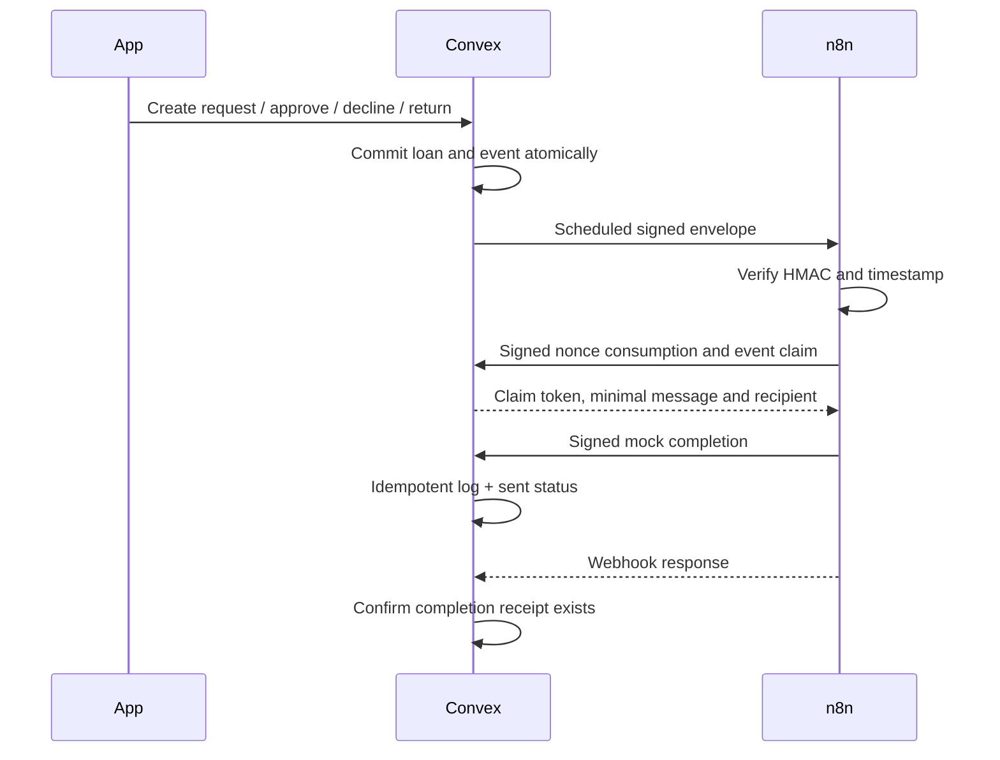

# LendLoop automation — implemented local design

Updated 5 November 2026. The local Docker instance contains three imported workflows, encrypted credentials, and published request/reminder workflows. Delivery uses a **logged mock**, not email or Slack. The integration was exercised against the development Convex deployment.

## What runs where

- Convex authenticates app users, commits loan state changes with durable events, schedules webhook delivery, validates signed integration calls, and stores delivery receipts.
- n8n orchestrates request notifications and daily overdue reminders. Its custom `LendLoop Automation` node signs/verifies requests using secrets from its encrypted credential store.
- A local nginx gateway exposes only `POST /webhook/lendloop-request-events` through an HTTPS Cloudflare quick tunnel. The editor is bound to localhost and is not routed through the gateway.
- `mockDeliveries` is the durable mock notification log. It stores a stable key, recipient ID, short message, and timestamp. A successful n8n completion atomically inserts the log and marks the event/reminder sent.

## Request workflow



The outbound event contains only event ID and type. The authenticated claim fetches the minimal recipient/message fields. Request creation targets the lender; decisions and return confirmation target the borrower. A plain HTTP 200 is insufficient: the dispatcher checks for a recorded completion.

## Daily reminder workflow

The schedule is **09:00 Asia/Kolkata**, configured in the workflow. It can also be run manually.

1. Fetch paginated approved loans whose inclusive end date is earlier than today's neighborhood date.
2. Request an atomic claim for `overdue:<loanId>:<localDate>`.
3. Skip already-sent or actively leased reminders.
4. Complete the mock delivery using the claim token. Convex rechecks that the loan remains overdue and unreturned.
5. Store the mock notification and reminder status in one transaction.
6. Continue through all pages; return sent/skipped totals.

An interrupted claim expires after 60 seconds. Successful acknowledgments can be repeated safely. A claim token from an expired/reassigned lease is rejected. If the loan was returned before completion, the reminder is skipped. A new local day has a new reminder key.

## Actual signed HTTP contract

All n8n → Convex operations use **POST `/automation/rpc`** on the deployment's `.convex.site` URL. These replace the earlier proposed separate routes.

```json
{
  "timestamp": 1793851200000,
  "nonce": "a-unique-random-uuid",
  "payload": "{\"operation\":\"reminders.list\",\"cursor\":null}",
  "signature": "64-character-lowercase-hex-hmac"
}
```

The HMAC-SHA256 input is the exact UTF-8 string `timestamp + '.' + nonce + '.' + payload`. Keeping `payload` as a string avoids parsed-JSON reserialization ambiguity. The same envelope format is used in the opposite direction with a **different** secret.

Receivers reject invalid signatures and timestamps outside five minutes. Convex stores RPC nonces and verified inbound webhook nonces to reject replay; expired entries are cleaned every ten minutes. Repeated business operations use fresh transport nonces and stable event/reminder keys.

| Operation | Purpose |
| --- | --- |
| `webhook.consume` | Reject duplicate inbound webhook nonce |
| `event.claim` | Lease an event or report that it is already delivered |
| `event.complete` | Atomically write mock notification and event result |
| `reminders.list` | Return at most 50 overdue candidates and a pagination cursor |
| `reminder.claim` | Recheck eligibility and lease this loan/day |
| `reminder.complete` | Recheck loan, log reminder once, and acknowledge |
| `failure.record` | Deduplicate a sanitized workflow failure by execution ID |

Unsigned calls return 401. Transport replay returns 409. Invalid operation bodies or stale claims return 400. Only this fixed set of integration operations is available; external callers cannot invoke arbitrary internal functions.

## Retries and failures

- Convex schedules up to five webhook attempts with exponential backoff and jitter. Timeouts and temporary server/rate-limit errors retry; configuration failures become visible terminal failures.
- n8n's custom node retries transient Convex RPC failures three times using fresh signed envelopes.
- The overdue node retries failed executions up to three times, allowing stale leases to expire between attempts.
- The custom node records sanitized failures before rethrowing. The two primary workflows also reference the Error Trigger workflow, which records execution failure. Failures remain visible in n8n when Convex cannot be reached.
- Admin → Automation health shows recent event status, attempts, errors, and recorded workflow failures. Admins can retry terminal event failures.
- Loan participants can expand Automation activity to view reminder dates/status. This is backend-authorized.
- Reminder delivery is logged, not emailed. Database idempotency is sufficient for this mock adapter. A real external provider would require provider idempotency or reconciliation for timeouts after provider acceptance.

## Credentials and local files

`node scripts/setup-automation.mjs` generates private directional secrets, configures them in Convex without printing values, and prepares an n8n credential import. It preserves existing generated secrets on rerun.

- `.automation-secrets.local.json`: private setup values; mode 0600; Git-ignored.
- `.n8n-credentials.local.json`: private import file; mode 0600; Git-ignored; never commit/export/share it.
- `.env.n8n`: stable encryption key and timezone; Git-ignored. Back up this encryption key privately with the Docker volume; changing it prevents decryption of existing credentials.
- Imported workflow JSON includes credential references only. Credential values are encrypted in n8n's persistent database.
- `n8n/custom/` contains source only; no secrets. It is required alongside the exported workflows.

## Running the setup already prepared here

```bash
cd /Users/rounakgupta/Desktop/Fluence
docker compose up -d
node scripts/sync-webhook-url.mjs
```

Open http://localhost:5678 and sign into your local owner account. The request workflow and daily workflow are published. The error workflow is attached to both. Keep Docker running for notifications/reminders to execute.

After the tunnel is recreated, run `sync-webhook-url.mjs` again: quick-tunnel addresses can change. No owned domain is required for this local demo. Quick tunnels are for development; use a stable secured endpoint in production. Only the webhook route is public; gateway `/` returns 404.

## Recreating on another machine

1. Set up Clerk/Convex per USAGE.md; install Docker Desktop.
2. Run `node scripts/setup-automation.mjs` and `docker compose up -d`.
3. Create the local n8n owner account at http://localhost:5678.
4. Import credentials without displaying their values:
   `docker compose exec -T n8n n8n import:credentials --input=/opt/lendloop-credentials.json`
5. Import workflows:
   `docker compose exec -T n8n n8n import:workflow --separate --input=/opt/lendloop-workflows`
6. Publish the request workflow and daily reminder workflow in the editor. Confirm the custom node has the LendLoop Automation API credential selected and the error workflow is attached in workflow settings.
7. Restart n8n after CLI imports/publication if using CLI rather than editor.
8. Run `node scripts/sync-webhook-url.mjs` after the tunnel URL appears in Docker logs.
9. Deploy backend with `npx convex dev --once`.
10. Run the two-user request flow; check n8n Executions and Convex `automationEvents` / `mockDeliveries` tables.

## Verification performed

- Unit/integration-style tests for HMAC tampering, timestamp expiry, HTTP replay, event/reminder idempotency, stale claims, return-before-reminder completion, and bounded retries.
- Live request event: one attempt, sent receipt recorded.
- Live overdue demo: first run sent one reminder; second run skipped it without duplication.
- Live completed-event replay safely skipped; exact-envelope replay and tampered signatures rejected.
- Negative tests deliberately produce failure entries in n8n and Automation health. These are expected test evidence, not unexplained application errors.
- The synthetic demo listing is inactive and hidden, and its loan was marked returned after verification. Its audit records remain for review.
